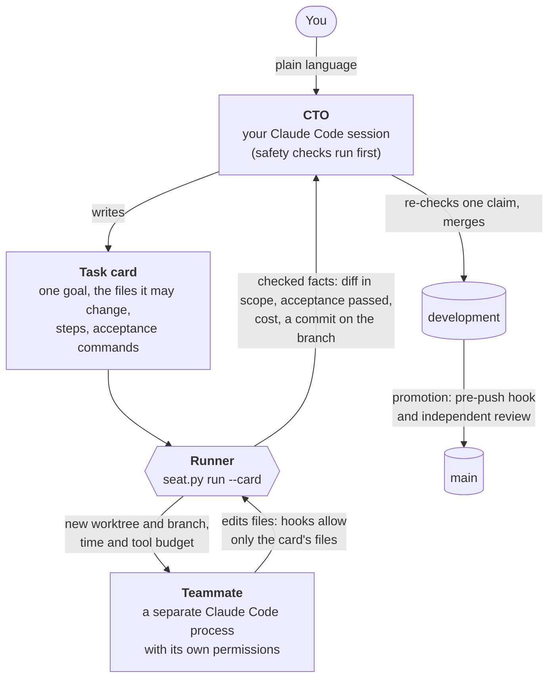
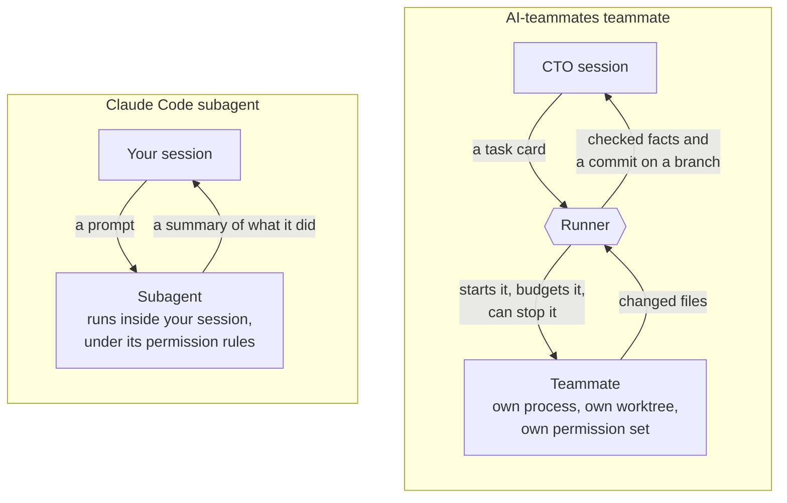
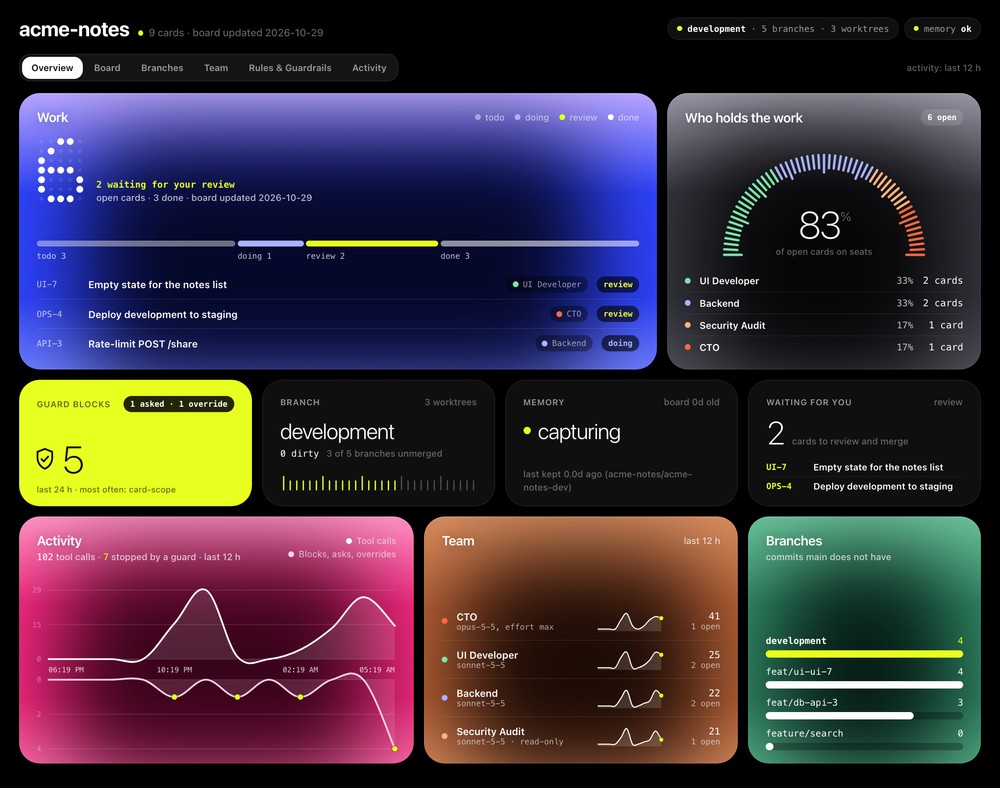
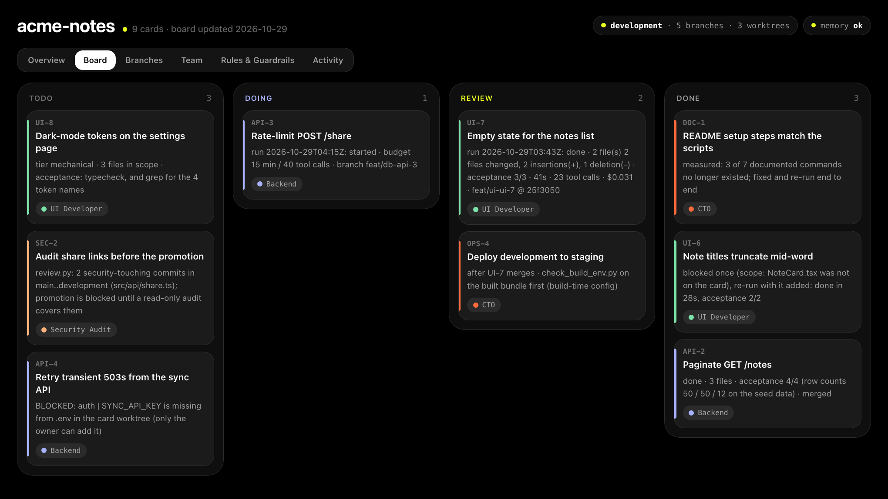
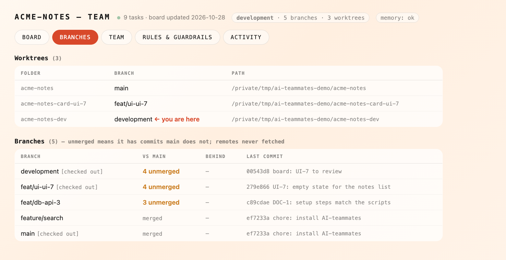
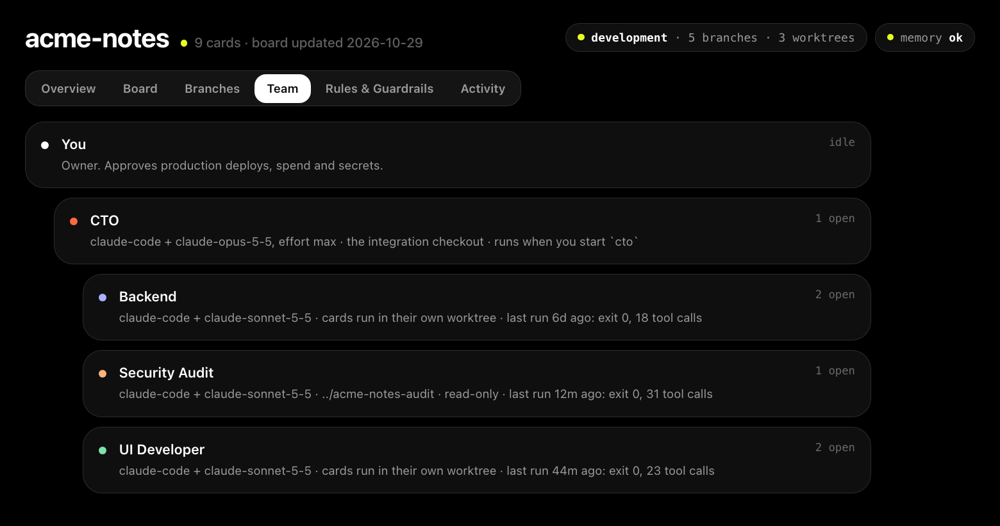
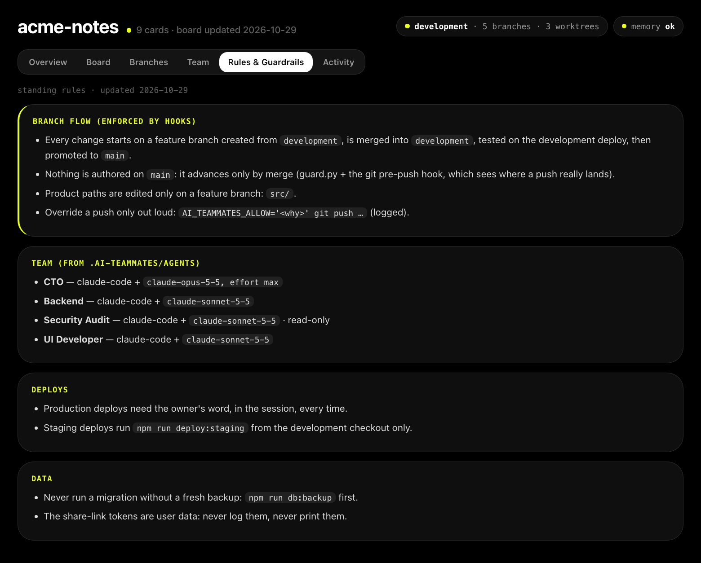
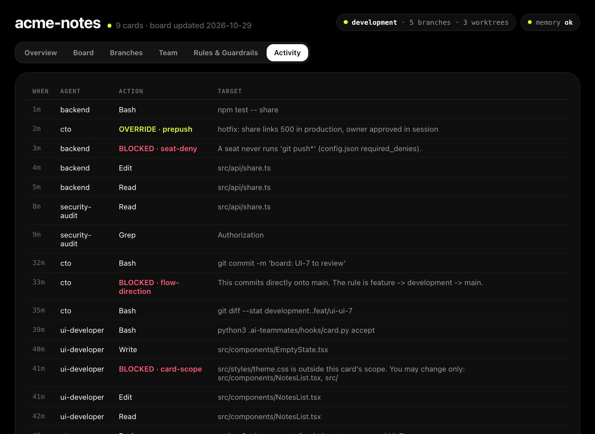

# AI-teammates

[](https://github.com/iezzat001/AI-teammates/actions/workflows/ci.yml)
[](LICENSE)

**A CTO agent for your terminal, a small team of specialist agents it delegates to, and
guardrails that stop them from breaking your project.**

You type `cto` inside your project and describe work in plain language. The CTO decides
whether to do it itself or hand it to a teammate as a small, checkable task card. It
reviews what comes back and tells you what it verified and what it only assumes.

Built on [Claude Code](https://claude.com/claude-code). Works with any git project.

> **Status: early.** Extracted from one production project and in use on a second.
> Don't point it at anything you can't afford to have an agent break. See
> [SECURITY.md](SECURITY.md) for what the guardrails do and don't protect against.

---

## What you get

| | |
|---|---|
| **`cto`** | An interactive Claude Code session that runs safety checks before you type. |
| **Teammates** | UI, backend and security-audit agents. Each runs one task card in its own git worktree, with a time and tool budget. |
| **Guardrails** | Git and Claude Code hooks: no unreviewed product code on your main branches, teammates edit only the files their card names, and an agent that keeps hitting the same wall stops and asks you. |
| **Proof, not promises** | A card is "done" only when its acceptance commands pass. The runner executes them; the agent's own report doesn't count. |
| **A dashboard** | A local page with the board, branches, team, rules and every guard block, live from your repository. |

---

## How it works



1. **You** describe the work. The **CTO** decides whether to do it itself or delegate it.
2. Delegated work becomes a **task card**: what must be true afterwards, the exact files that may
   change, and commands that prove it. A card that is too big is refused and split.
3. The **runner** starts a teammate in a fresh git worktree, enforces its budget, and stops it if
   it stalls. Hooks refuse any edit outside the card's files while it works.
4. The runner, not the teammate, decides the result: it checks the git diff against the card and
   **executes the acceptance commands**. Only then does it commit to the card's branch.
5. The CTO re-checks one key claim, merges into `development`, and promotion to `main` passes the
   pre-push hook and, for changes to auth or spend, an independent read-only audit.

Every rule here exists because something broke: read [the failure catalogue](docs/07-FAILURE-CATALOGUE.md)
for the nine recurring ways agent work went wrong, and how each one is now caught.

---

## How is this different from Claude Code's subagents?

Claude Code's [subagents](https://code.claude.com/docs/en/sub-agents) are great for work inside your
session: research, a review, a focused change you will look at yourself. A teammate here is built
for changes to your product that must be **proven and reviewed before they land**.



| | Claude Code subagent | AI-teammates teammate |
|---|---|---|
| **It is given** | a prompt | a task card: one goal, the files it may change, steps, acceptance commands (refused if too big) |
| **It runs** | inside your session, with your session's permission rules | as a separate `claude -p` process with its own allowlist, prompts denied, and none of your plugins or MCP servers |
| **It may change** | whatever its tools and your permissions allow | only the card's files: refused live by a hook, checked again from the git diff |
| **Where** | your checkout, or an optional temporary worktree | always its own worktree and branch, cut from `development` |
| **"Done" means** | its summary says so | the runner executed the acceptance commands and they passed |
| **Limits** | a turn limit (`maxTurns`) | wall time, tool calls and idle time; the process is stopped past them |
| **Blocked on you** | asks through your session's permission prompts | stops, records `BLOCKED: <what it needs>`, and the next `cto` session starts with it |
| **Record** | the session transcript | every run: status, files, acceptance results, cost; its board card moves |
| **Reaches `main`** | however you commit it | only by merge through `development`, past the pre-push hook |

---

## The dashboard

A local page that shows your project as the guardrails see it, computed live from git, the board,
the teammate specs, your config and the hooks' event log:

```bash
python3 .ai-teammates/hooks/dashboard_server.py     # then open http://127.0.0.1:8899
```



| Tab | What it shows |
|---|---|
| **Overview** | One screen: open cards and what's in flight, who holds the work (and how much is delegated to seats), what the guards refused, the current branch, whether memory is capturing, what waits for your review, activity over the day, each teammate's activity, and unmerged branches. |
| **Board** | Every task card by column, with the facts of its last run: files, acceptance results, time, cost, branch. |
| **Branches** | Worktrees and branches, what each has that `main` doesn't, and where you are. Computed per request, never cached. |
| **Team** | You, the CTO and each teammate: model, where it runs, its last run, its open cards. |
| **Rules & Guardrails** | The branch flow the hooks enforce and the team, generated from your config, plus your own `RULES.md`. |
| **Activity** | Every tool call, and every **BLOCKED** and **OVERRIDE** from the hooks, newest first. |

The header always shows the current branch, how many branches and worktrees exist, uncommitted
files, and whether memory capture is actually working.

<details>
<summary><b>Screenshots of the other tabs</b></summary>

**Board**


**Branches**


**Team**


**Rules & Guardrails**


**Activity**


</details>

The screenshots come from an invented demo project. Rebuild them, or try the dashboard without
installing anything into a real project: `python3 scripts/dashboard_demo.py`.

---

## Requirements

| Tool | Version | Needed for |
|---|---|---|
| [Claude Code](https://claude.com/claude-code) (`claude`), signed in | recent | everything |
| `git` | 2.25 or newer | worktrees |
| `python3` | 3.9 or newer, standard library only | the hooks |
| [claude-mem](https://github.com/thedotmack/claude-mem) | optional | remembering past sessions |
| [MemPalace](https://github.com/MemPalace/mempalace) | optional | memory slices on task cards |

Tested on macOS and Linux (CI runs the full suite on both).

---

## Quick start

**1. Get AI-teammates** (once per machine):

```bash
git clone https://github.com/iezzat001/AI-teammates.git ~/AI-teammates
```

**2. Install it into your project:**

```bash
cd ~/code/your-project
~/AI-teammates/install.sh
```

This adds `.ai-teammates/` to your project, registers the hooks, and puts `cto` and
`ai-teammates` in `~/.local/bin` (add that folder to your `PATH` if the installer says so).

**3. Commit the install:**

```bash
git add .ai-teammates .claude/settings.json opencode.json
git commit -m "chore: install AI-teammates"
```

Until this is committed, new worktrees start without guardrails.

**4. Create the integration branch and its own checkout:**

Work flows `feature branch -> development -> main`. The CTO works in the `development`
checkout, never on `main`:

```bash
git branch development
git worktree add ../your-project-dev development
```

Skip this step if your project already has a `development` branch with a checkout.

**5. Start the CTO:**

```bash
cd ../your-project-dev
cto --doctor    # check your setup
cto             # start talking
```

---

## Everyday use

```bash
cto                      # interactive session: give it a task, read the report, give it the next
cto "fix the typo in the pricing page"    # one task, headless, exits when done
cto --doctor             # check the environment
ai-teammates install     # upgrade the hooks and docs in this project (your config is kept)
ai-teammates uninstall   # remove everything cleanly
```

The CTO delegates through task cards. You rarely run these yourself, but this is what it does:

```bash
python3 .ai-teammates/hooks/card.py new UI-1 --seat ui-developer --tier mechanical --title "..." --goal "..."
python3 .ai-teammates/hooks/card.py check UI-1        # too big? it tells you to split it
python3 .ai-teammates/hooks/seat.py run --card UI-1   # runs, checks scope, executes acceptance, commits
```

---

## Configure

Everything project-specific lives in `.ai-teammates/config.json`. The installer fills it
in from your repository; check it before real work:

```json
{
  "protected_branches": ["main", "development"],
  "guarded_paths": ["src/", "app/"],
  "cto": { "provider": "anthropic", "model": "claude-opus-5-5", "effort": "max" }
}
```

| Key | What it means |
|---|---|
| `protected_branches` | `[production, integration]`. Nothing is committed directly to these; they move only by merge. |
| `guarded_paths` | What counts as product code. Changes there must arrive through a feature branch. **Get this one right:** too narrow lets unreviewed code through; too broad makes every doc edit a ceremony. |
| `cto.model` | `default` uses Claude Code's default model. [04-ROUTING](docs/04-ROUTING.md) explains the measured choice per role. |

Project rules the CTO must always follow go in `.ai-teammates/RULES.md` (the installer never
overwrites it). All other keys are described in the docs below.

---

## Documentation

| Doc | Answers |
|---|---|
| [00 Start here](docs/00-START-HERE.md) | Install, first session, what to expect |
| [01 Workflow](docs/01-WORKFLOW.md) | Branches, worktrees, the board, the dashboard |
| [02 Guardrails](docs/02-GUARDRAILS.md) | Every rule and the incident that created it |
| [03 Team](docs/03-TEAM.md) | The teammates, and how to add one |
| [04 Routing](docs/04-ROUTING.md) | Which model does which job, and what it costs |
| [05 CTO](docs/05-CTO.md) | The CTO's job, powers and review protocol |
| [06 Memory](docs/06-MEMORY.md) | How memory is captured and kept true |
| [07 Failure catalogue](docs/07-FAILURE-CATALOGUE.md) | The nine recurring failure shapes |
| [08 New project](docs/08-NEW-PROJECT.md) | The first sessions on an unfamiliar codebase |

---

## Uninstall

```bash
ai-teammates uninstall
```

Don't just delete `.ai-teammates/`: the hooks stay registered, and Claude Code then refuses
every tool call in the project.

---

## Contributing

Contributions are welcome. Start with [CONTRIBUTING.md](CONTRIBUTING.md): how to run the
test suite in a minute, and the one rule every change follows (a guardrail must execute,
not describe). AI coding agents read [AGENTS.md](AGENTS.md); planned work is in the
[issues](https://github.com/iezzat001/AI-teammates/issues). Please follow the [Code of Conduct](CODE_OF_CONDUCT.md). Report security
issues privately as described in [SECURITY.md](SECURITY.md).

## License

[Apache-2.0](LICENSE). Copyright 2026 Ahmed Ezzat.
